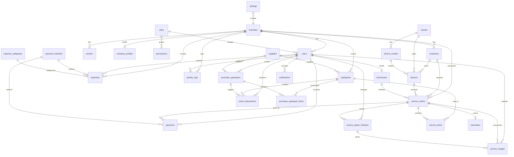

# ERD — Sistem Informasi Service HP

Dokumen ini mendeskripsikan skema database yang dinormalisasi minimal **3NF (Third Normal Form)**.

## Prinsip Normalisasi

| Normal Form | Penerapan |
|-------------|-----------|
| **1NF** | Setiap kolom atomic; tidak ada repeating groups (spare part di service dipisah ke `service_items`) |
| **2NF** | Semua atribut non-key bergantung pada seluruh primary key (line items terpisah dari header) |
| **3NF** | Tidak ada transitive dependency — kategori pengeluaran di `expense_categories`, metode bayar di `payment_methods`, role di `roles`, bukan di `users` |

## Diagram ERD



## Daftar Tabel (28 entitas + 2 pivot)

| # | Tabel | Deskripsi | UUID | Soft Delete |
|---|-------|-----------|------|-------------|
| 1 | `branches` | Cabang toko | Ya | Ya |
| 2 | `roles` | Role pengguna (owner, admin, kasir, teknisi) | - | Ya |
| 3 | `permissions` | Hak akses granular | - | Ya |
| 4 | `permission_role` | Pivot role ↔ permission | - | - |
| 5 | `users` | Akun sistem | Ya | Ya |
| 6 | `company_profiles` | Profil perusahaan per cabang | - | Ya |
| 7 | `customers` | Data pelanggan | Ya | Ya |
| 8 | `brands` | Merek HP | - | Ya |
| 9 | `device_models` | Model perangkat | - | Ya |
| 10 | `devices` | Unit HP milik pelanggan | Ya | Ya |
| 11 | `technicians` | Profil teknisi (1:1 user) | - | Ya |
| 12 | `suppliers` | Pemasok spare part | - | Ya |
| 13 | `spareparts` | Master spare part + stok | Ya | Ya |
| 14 | `service_orders` | Tiket service | Ya | Ya |
| 15 | `service_status_histories` | Histori perubahan status | - | - |
| 16 | `service_items` | Spare part per order | - | - |
| 17 | `service_images` | Foto unit / status | - | - |
| 18 | `warranties` | Garansi service | - | Ya |
| 19 | `purchase_spareparts` | Header pembelian spare part | Ya | Ya |
| 20 | `purchase_sparepart_items` | Detail item pembelian | - | - |
| 21 | `stock_transactions` | Mutasi stok | - | - |
| 22 | `payment_methods` | Master metode pembayaran | - | Ya |
| 23 | `payments` | Pembayaran service | Ya | Ya |
| 24 | `expense_categories` | Kategori pengeluaran | - | Ya |
| 25 | `expenses` | Pengeluaran operasional | Ya | Ya |
| 26 | `notifications` | Notifikasi user | Ya | - |
| 27 | `settings` | Konfigurasi key-value | - | - |
| 28 | `activity_logs` | Audit trail | - | - |
| 29 | `printers` | Konfigurasi printer cabang | - | Ya |

## Relasi Detail

### Organisasi & Auth
- `users.branch_id` → `branches.id` (SET NULL)
- `users.role_id` → `roles.id` (RESTRICT)
- `permission_role.role_id` → `roles.id` (CASCADE)
- `permission_role.permission_id` → `permissions.id` (CASCADE)
- `company_profiles.branch_id` → `branches.id` (CASCADE)
- `technicians.user_id` → `users.id` (CASCADE)
- `technicians.branch_id` → `branches.id` (CASCADE)

### Pelanggan & Perangkat
- `customers.branch_id` → `branches.id` (CASCADE)
- `devices.customer_id` → `customers.id` (CASCADE)
- `devices.brand_id` → `brands.id` (SET NULL)
- `devices.device_model_id` → `device_models.id` (SET NULL)
- `device_models.brand_id` → `brands.id` (CASCADE)

### Service
- `service_orders.branch_id` → `branches.id` (CASCADE)
- `service_orders.customer_id` → `customers.id` (RESTRICT)
- `service_orders.device_id` → `devices.id` (SET NULL)
- `service_orders.technician_id` → `technicians.id` (SET NULL)
- `service_orders.created_by` → `users.id` (SET NULL)
- `service_status_histories.service_order_id` → `service_orders.id` (CASCADE)
- `service_status_histories.changed_by` → `users.id` (RESTRICT)
- `service_items.service_order_id` → `service_orders.id` (CASCADE)
- `service_items.sparepart_id` → `spareparts.id` (RESTRICT)
- `service_images.service_order_id` → `service_orders.id` (CASCADE)
- `service_images.service_status_history_id` → `service_status_histories.id` (SET NULL)
- `service_images.uploaded_by` → `users.id` (SET NULL)
- `warranties.service_order_id` → `service_orders.id` (CASCADE)

### Inventori & Pembelian
- `spareparts.branch_id` → `branches.id` (CASCADE)
- `spareparts.supplier_id` → `suppliers.id` (SET NULL)
- `purchase_spareparts.branch_id` → `branches.id` (CASCADE)
- `purchase_spareparts.supplier_id` → `suppliers.id` (RESTRICT)
- `purchase_spareparts.created_by` → `users.id` (RESTRICT)
- `purchase_sparepart_items.purchase_sparepart_id` → `purchase_spareparts.id` (CASCADE)
- `purchase_sparepart_items.sparepart_id` → `spareparts.id` (RESTRICT)
- `stock_transactions.sparepart_id` → `spareparts.id` (CASCADE)
- `stock_transactions.branch_id` → `branches.id` (CASCADE)
- `stock_transactions.user_id` → `users.id` (RESTRICT)
- `stock_transactions.reference` → polymorphic (`reference_type`, `reference_id`)

### Keuangan
- `payments.service_order_id` → `service_orders.id` (CASCADE)
- `payments.payment_method_id` → `payment_methods.id` (RESTRICT)
- `payments.received_by` → `users.id` (RESTRICT)
- `payments.branch_id` → `branches.id` (CASCADE)
- `expenses.expense_category_id` → `expense_categories.id` (RESTRICT)
- `expenses.payment_method_id` → `payment_methods.id` (SET NULL)
- `expenses.branch_id` → `branches.id` (CASCADE)
- `expenses.user_id` → `users.id` (RESTRICT)

### Sistem
- `settings.branch_id` → `branches.id` (CASCADE, nullable = global)
- `notifications.user_id` → `users.id` (CASCADE)
- `activity_logs.user_id` → `users.id` (SET NULL)
- `activity_logs.branch_id` → `branches.id` (SET NULL)
- `printers.branch_id` → `branches.id` (CASCADE)

## Workflow Status Service

```
received → diagnosis → waiting_approval → in_service → qc
→ completed → picked_up → warranty → closed
(+ cancelled)
```

Disimpan di `service_orders.status` (denormalized cache) dan `service_status_histories` (audit lengkap).

## Index Rekomendasi

- `service_orders`: `(branch_id, ticket_number)` UNIQUE, `(status)`, `(customer_id)`
- `customers`: `(branch_id, code)` UNIQUE, `(phone)`
- `spareparts`: `(branch_id, code)` UNIQUE
- `stock_transactions`: `(sparepart_id, created_at)`
- `activity_logs`: `(subject_type, subject_id)`, `(user_id, created_at)`
